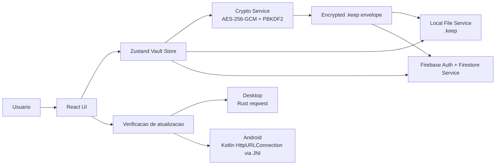
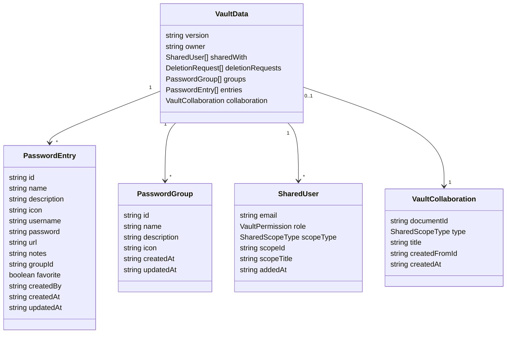
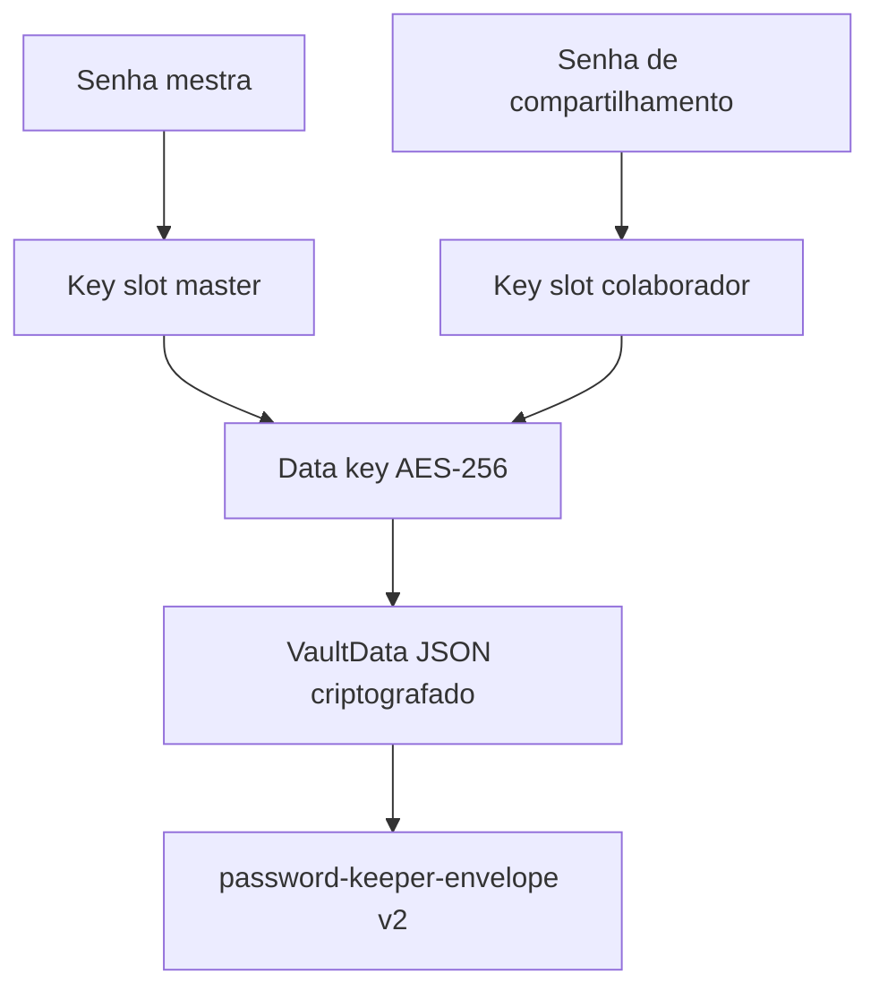
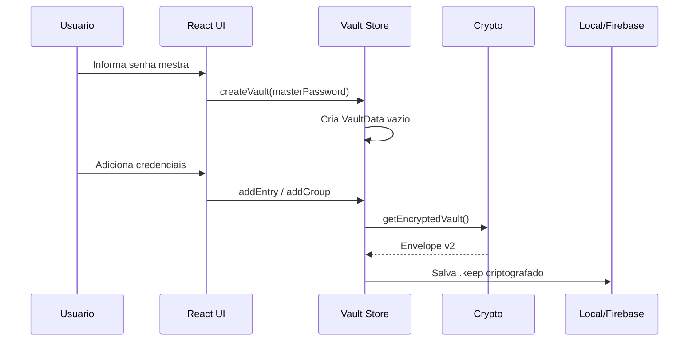
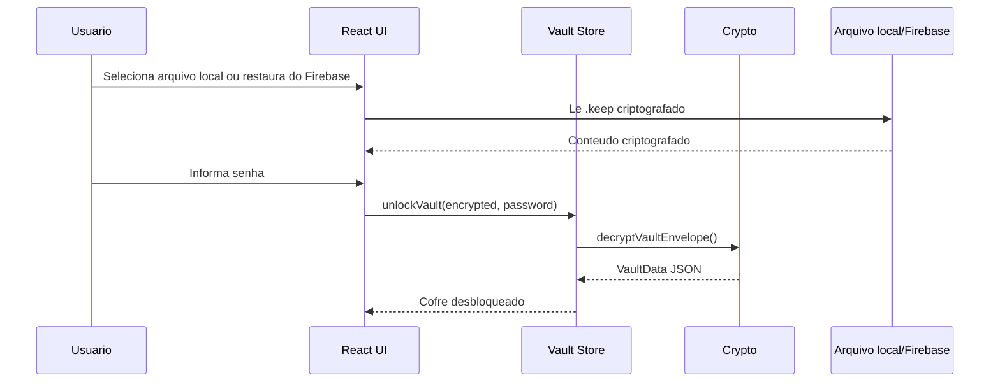
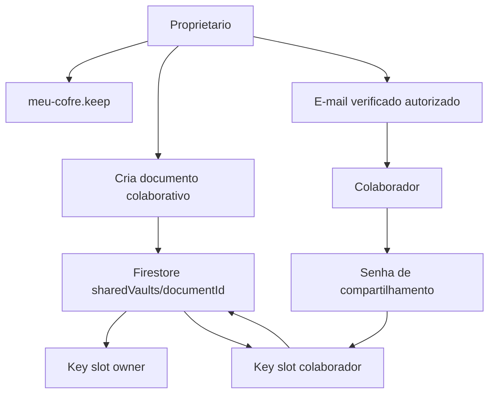
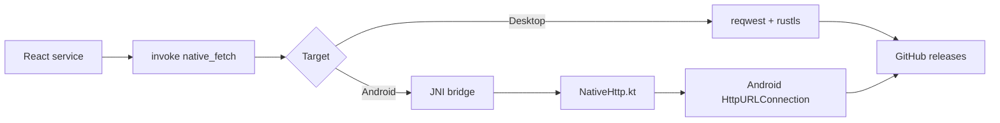

# Password Keeper

Password Keeper e um cofre de senhas multiplataforma feito com **Tauri 2**, **React 18**, **TypeScript**, **Rust** e **Zustand**. O projeto criptografa credenciais pessoais e compartilhadas antes da persistencia local ou do envio aos servicos de sincronizacao.

O objetivo deste README e ser o documento de referencia do projeto: produto, arquitetura, seguranca, fluxos, desenvolvimento, release e downloads.

## Downloads

Versao publica mais recente: **v0.2.13**

Pagina da release: [Password Keeper v0.2.13](https://github.com/Praesens-tech/passwordKeeper/releases/tag/v0.2.13)

| Plataforma | Arquivo recomendado | Link direto |
|---|---:|---|
| Windows | `.exe` installer | [Password.Keeper_0.2.13_x64-setup.exe](https://github.com/Praesens-tech/passwordKeeper/releases/download/v0.2.13/Password.Keeper_0.2.13_x64-setup.exe) |
| Windows | `.msi` installer | [Password.Keeper_0.2.13_x64_en-US.msi](https://github.com/Praesens-tech/passwordKeeper/releases/download/v0.2.13/Password.Keeper_0.2.13_x64_en-US.msi) |
| macOS Apple Silicon | `.dmg` | [Password.Keeper_0.2.13_aarch64.dmg](https://github.com/Praesens-tech/passwordKeeper/releases/download/v0.2.13/Password.Keeper_0.2.13_aarch64.dmg) |
| macOS Intel | `.dmg` | [Password.Keeper_0.2.13_x64.dmg](https://github.com/Praesens-tech/passwordKeeper/releases/download/v0.2.13/Password.Keeper_0.2.13_x64.dmg) |
| Linux | `.AppImage` | [Password.Keeper_0.2.13_amd64.AppImage](https://github.com/Praesens-tech/passwordKeeper/releases/download/v0.2.13/Password.Keeper_0.2.13_amd64.AppImage) |
| Linux Debian/Ubuntu | `.deb` | [Password.Keeper_0.2.13_amd64.deb](https://github.com/Praesens-tech/passwordKeeper/releases/download/v0.2.13/Password.Keeper_0.2.13_amd64.deb) |
| Linux Fedora/RHEL | `.rpm` | [Password.Keeper-0.2.13-1.x86_64.rpm](https://github.com/Praesens-tech/passwordKeeper/releases/download/v0.2.13/Password.Keeper-0.2.13-1.x86_64.rpm) |
| Android | `.apk` side-loading | [PasswordKeeper-0.2.13-android.apk](https://github.com/Praesens-tech/passwordKeeper/releases/download/v0.2.13/PasswordKeeper-0.2.13-android.apk) |

Observacoes:

- O APK Android e assinado por keystore configurada no GitHub Actions.
- macOS e Windows ainda podem exigir confirmacao manual do sistema operacional, dependendo de notarizacao e assinatura do ambiente do usuario.
- Para Android, o APK e distribuido por side-loading. Ative instalacao de fontes confiaveis apenas se voce entende o risco.

## O Que o Produto Faz

Password Keeper mantém o cofre em um arquivo .keep criptografado localmente. Com uma conta Password Keeper, o usuário pode enviar uma cópia cifrada ao Firebase para backup e compartilhamento. A senha mestra não é enviada ao Firebase.

Principais recursos:

- Cofre local criptografado com senha mestra.
- Entradas com nome, usuario, senha, URL, descricao, notas e icone.
- Grupos para organizar credenciais.
- Favoritos, busca, visualizacao em grade/lista e detalhes protegidos.
- Gerador de senhas com opcoes de letras, numeros e simbolos.
- Medidor de forca da senha.
- Salvar e abrir arquivo local `.keep`.
- Escolher a localizacao do arquivo `.keep` ao criar um cofre novo no desktop.
- Enviar backup criptografado do cofre pessoal ao Firebase.
- Sincronizar backups e compartilhar cofres, grupos e entradas por documentos Firebase separados.
- Compartilhar cofre, grupo ou entrada como documento colaborativo separado.
- Permissoes por colaborador: leitor, editor e proprietario.
- Senha de compartilhamento separada da senha mestra.
- Auto-save apos alteracoes.
- Auto-lock por inatividade.
- Builds para Linux, Windows, macOS e Android.

## Pagina do Produto

A pagina promocional para GitHub Pages fica em:

- [docs/index.html](docs/index.html)
- Imagem hero: [docs/assets/password-keeper-hero.png](docs/assets/password-keeper-hero.png)

Quando o GitHub Pages estiver apontando para a pasta `docs`, a URL esperada sera:

```text
https://passwordkeeper.praesens.tech/
```

A pagina tem portugues como idioma padrao e alternancia para ingles.
Ela tambem inclui links de download por plataforma e um historico simples de versoes para usuarios finais.

## Stack Tecnica

| Camada | Tecnologia |
|---|---|
| App shell | Tauri 2 |
| Backend nativo | Rust |
| Frontend | React 18 + TypeScript |
| Estado | Zustand |
| Estilo | Tailwind CSS |
| Build web | Vite |
| Testes | Vitest + Testing Library + happy-dom |
| Criptografia | Web Crypto API |
| HTTP desktop | Rust `reqwest` via comando Tauri |
| HTTP Android | Kotlin `HttpURLConnection` via JNI |
| Autenticacao | Firebase Authentication por e-mail e senha verificados |
| Cloud | Firebase Authentication + Firestore |
| CI/CD | GitHub Actions |

## Arquitetura Geral



### Principios

1. O cofre descriptografado vive apenas em memoria.
2. Toda persistencia usa conteudo criptografado.
3. A senha mestra nao e persistida.
4. O Firebase guarda apenas envelopes cifrados e metadados mínimos de acesso.
5. Compartilhamentos usam documentos separados no Firestore.
6. Permissoes da interface sao aplicadas a partir do papel do usuario e do escopo compartilhado.

## Modelo de Dados

Os tipos principais ficam em [src/types/vault.ts](src/types/vault.ts).



### Permissoes

| Papel | Pode visualizar | Pode criar/editar | Pode excluir | Pode gerenciar acesso |
|---|---:|---:|---:|---:|
| `reader` | Sim | Nao | Nao | Nao |
| `editor` | Sim | Sim | Via fluxo autorizado | Nao |
| `owner` | Sim | Sim | Sim | Sim |

Escopos possiveis:

- `vault`: cofre inteiro.
- `group`: grupo e entradas do grupo.
- `entry`: entrada especifica.

## Criptografia

Implementacao: [src/services/crypto.ts](src/services/crypto.ts)

### Algoritmos

- **AES-256-GCM** para cifrar o payload.
- **PBKDF2 SHA-256** para derivar chave a partir de senha.
- **310.000 iteracoes** no PBKDF2.
- Salt de 16 bytes por slot de senha.
- IV de 12 bytes para AES-GCM.
- Chave interna de dados de 32 bytes para envelope v2.

### Envelope v2

O formato atual separa a chave que cifra os dados das senhas autorizadas. Cada senha desbloqueia um `keySlot`, e o `keySlot` desbloqueia a mesma chave de dados.



Formato conceitual:

```json
{
  "format": "password-keeper-envelope",
  "version": 2,
  "payload": {
    "iv": "base64",
    "data": "base64"
  },
  "keySlots": [
    {
      "id": "master",
      "salt": "base64",
      "iv": "base64",
      "encryptedKey": "base64",
      "createdAt": "iso-date"
    }
  ]
}
```

### Legado v1

O app ainda consegue ler o formato legado:

```text
[16 bytes salt][12 bytes iv][ciphertext]
```

Novos arquivos usam envelope v2.

## Fluxos Principais

### Criar Cofre



### Abrir Cofre



### Compartilhamento Colaborativo

Compartilhar nao expoe o arquivo principal do usuario. O app cria um documento separado no Firestore:

```text
sharedVaults/<documentId>
```

Esse documento contem apenas o escopo compartilhado: cofre inteiro, grupo ou entrada. O conteudo usa envelope v2 cifrado, key slots do proprietario e colaborador, e acesso associado a uma conta com e-mail confirmado.



### Edicao em Compartilhamento

- Leitores visualizam.
- Editores escrevem no documento colaborativo do Firestore.
- Proprietarios sincronizam alteracoes recebidas para o cofre principal.
- Entradas e grupos compartilhados recebem IDs namespaced no cliente, por exemplo:

```text
shared:<sourceId>:entry:<entryId>
shared:<sourceId>:group:<groupId>
```

Isso evita colisao entre IDs locais e IDs recebidos.

## Tauri e Backend Nativo

Arquivo principal: [src-tauri/src/lib.rs](src-tauri/src/lib.rs)

Comandos expostos ao frontend:

| Comando | Finalidade |
|---|---|
| `native_fetch` | Proxy HTTP nativo para contornar CORS e restricoes do WebView |
| `write_file` | Escreve arquivo local |
| `read_file` | Le arquivo local |
| `get_default_vault_path` | Retorna caminho padrao do cofre |
| `pick_and_read_image` | Seleciona icone/imagem no desktop |
| `open_url` | Abre URL no navegador do sistema |
| `exit_app` | Encerra o app |

### HTTP por Plataforma



Motivo do caminho especial no Android: threads NDK podem falhar em DNS e sockets em alguns ambientes Android. Por isso o app delega chamadas HTTP para Kotlin.

## Persistencia Local

Camadas:

1. Arquivo `.keep` criptografado no disco.
2. `@tauri-apps/plugin-store` para preferencias e referencias.
3. `localStorage` como fallback sincronizado para cold-start.

Chaves sensiveis devem ficar no Tauri Store. A senha mestra nao e persistida.

## Interface

Componentes principais:

| Arquivo | Responsabilidade |
|---|---|
| [src/App.tsx](src/App.tsx) | Layout principal, auto-save, listeners Firestore e auto-lock |
| [src/components/MasterPasswordScreen.tsx](src/components/MasterPasswordScreen.tsx) | Criar, abrir e desbloquear cofres |
| [src/components/Sidebar.tsx](src/components/Sidebar.tsx) | Navegacao, grupos, filtros e conta Firebase |
| [src/components/PasswordGrid.tsx](src/components/PasswordGrid.tsx) | Lista/grade de credenciais |
| [src/components/PasswordDetail.tsx](src/components/PasswordDetail.tsx) | Detalhe e acoes da credencial |
| [src/components/PasswordForm.tsx](src/components/PasswordForm.tsx) | Criar/editar credencial |
| [src/components/ShareModal.tsx](src/components/ShareModal.tsx) | Criar compartilhamento |
| [src/components/BackupModal.tsx](src/components/BackupModal.tsx) | Backup e exportacao |

## Estrutura do Repositorio

```text
password-keeper/
├── .github/workflows/
│   ├── release.yml
│   ├── security.yml
│   └── build-windows.yml
├── docs/
│   ├── index.html
│   ├── assets/
│   └── release-readiness.md
├── public/
├── scripts/
│   └── sync-version.js
├── src/
│   ├── components/
│   ├── hooks/
│   ├── services/
│   ├── store/
│   ├── types/
│   └── utils/
└── src-tauri/
    ├── capabilities/
    ├── gen/android/
    ├── icons/
    ├── src/
    ├── Cargo.toml
    └── tauri.conf.json
```

## Requisitos de Desenvolvimento

- Node.js 20 recomendado.
- npm.
- Rust stable.
- Dependencias Tauri da plataforma.
- Para Android:
  - Android SDK.
  - Android NDK.
  - Java 17.
  - Targets Rust Android.
- Firebase project com Email/Password e Firestore configurados.

## Variaveis de Ambiente

Crie `.env` na raiz:

```env
VITE_FIREBASE_API_KEY=SEU_FIREBASE_API_KEY
VITE_FIREBASE_AUTH_DOMAIN=seu-projeto.firebaseapp.com
VITE_FIREBASE_PROJECT_ID=seu-projeto
VITE_FIREBASE_APP_ID=SEU_FIREBASE_APP_ID
```

O arquivo `.env` nao deve ser commitado.

## Firebase Authentication e Firestore

O app usa o Firebase configurado no arquivo .env.example. O provedor Email/Password e as regras Firestore já foram publicados no projeto `password-keeper-mpb-2026`. As contas precisam confirmar o e-mail; a política de senha forte deve ser configurada nas definições do Firebase Authentication.
